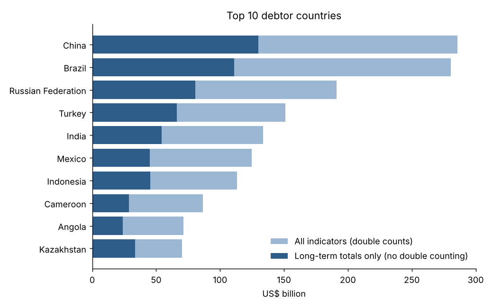

# Analysis of International Debt Statistics

SQL analysis of the World Bank's International Debt Statistics: how much developing
countries owe, to whom, and which debt indicators matter most.

The project started as the DataCamp "Analyze International Debt Statistics" exercise.
I extended it into a small, repeatable pipeline (CSV → cleaning → SQLite → SQL → charts)
and added a check for a problem the basic version misses: **the indicators double count**.

## Key results (real dataset)

| | |
|---|---|
| Country entries in the raw data | 124, of which 3 are regional aggregates (South Asia, IDA only, Least developed countries), so **121 countries** |
| Debt indicators | 25 |
| Top debtor | **China, US$ 285.79 bn** (sum of all indicators; US$ 129.78 bn without double counting), then Brazil and Russia |
| Double counting | 60% of the naive total (US$ 2.44 tn) is the same money counted at several levels |
| Who long-term principal is owed to | Private non-guaranteed 58%, private PPG 25%, official 16% |
| Main recommendation | Use long-term debt (DLXF) as the headline measure and split it by creditor |

Full output: [`reports/findings.md`](reports/findings.md) and [`outputs/`](outputs/).



> The numbers in `reports/findings.md` are regenerated on every run. If you run the
> project with the synthetic sample, they will be different and the report says so.

### Why "total debt" is tricky
The 25 indicators are hierarchical:

```
long-term (DLXF) = official PPG (OFFT) + private PPG (PRVT) + private non-guaranteed (DPNG)
OFFT             = bilateral (BLAT) + multilateral (MLAT)
PRVT             = bonds (PBND) + commercial banks (PCBK) + other private (PROP)
```

Adding all of them up (what most solutions do) counts the same dollar 2–3 times.
`sql/03_total_debt.sql` reports both the naive total and a de-duplicated total that only
sums the long-term series. I kept the naive number for comparison with the usual answer.

## Project structure

```
international-debt-analysis/
├── data/
│   ├── raw/                  # input CSV goes here (not committed, see data/README.md)
│   └── processed/            # SQLite database built by the pipeline
├── notebooks/
│   └── international_debt_analysis.ipynb   # exploration
├── scripts/
│   ├── fetch_worldbank.py    # download the indicators from the World Bank API
│   └── make_sample_data.py   # synthetic sample for offline testing
├── sql/
│   ├── schema.sql            # tables, indicator lookup, countries-only view
│   └── 01_… – 11_….sql       # one question per file
├── src/
│   ├── indicators.py         # indicator names + hierarchy levels
│   ├── cleaning.py           # validation and cleaning, writes a report
│   ├── db.py                 # builds the SQLite database
│   ├── charts.py             # matplotlib charts
│   └── run_analysis.py       # runs everything end to end
├── tests/                    # pytest: cleaning rules + SQL on a tiny known dataset
├── outputs/                  # query results (CSV) and charts (PNG)
└── reports/                  # findings.md, cleaning_report.md
```

## How to run

```bash
pip install -r requirements.txt

# 1. get the data (any one of these)
#    a) the DataCamp file is included at data/raw/international_debt.csv
#    b) python scripts/fetch_worldbank.py --year 2015
#    c) python scripts/make_sample_data.py      # synthetic, for testing only

# 2. run the pipeline
python -m src.run_analysis
#    or point it at a specific file
python -m src.run_analysis --data data/raw/international_debt_wb_2015.csv

# 3. tests
python -m pytest tests
```

## Questions answered (sql/)

1. How many distinct countries are there (aggregates excluded)?
2. Which indicators exist?
3. What is the total debt, naive vs de-duplicated?
4. Top 10 debtor countries
5. Which indicators have the highest average?
6. Who made the largest long-term principal repayment?
7. Which indicators are reported most often (coverage)?
8. For each top debtor, which single indicator is largest? (window function)
9. Who is long-term debt owed to? (creditor mix)
10. Which countries pay the most interest per dollar of principal?
11. Breakdown for China by flow type

## Data cleaning
`src/cleaning.py` checks and logs: column names, stray whitespace, exact duplicates,
conflicting duplicates (same country + indicator, different value), missing and negative
values, unknown indicator codes, one-name-per-code consistency, and regional/income
aggregates (flagged and excluded through the `countries_debt` view, not deleted).
Results are written to `reports/cleaning_report.md`.

## Limitations
- One year only, so no trend analysis. The fetch script takes a `--year` argument, so
  pulling several years would be the next step.
- These are flows (repayments, disbursements, interest), not the outstanding debt stock.
- Totals are not scaled by GDP or population, so big economies naturally rank first.

## Tools
Python (pandas, matplotlib), SQLite, SQL (CTEs, window functions, CASE aggregation), pytest.
